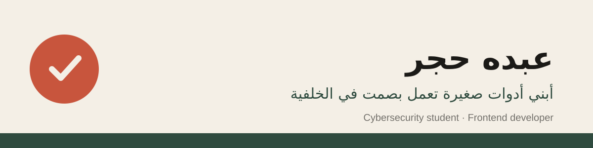

<!-- ضع هذا الملف في مستودع عام اسمه مطابق لاسم مستخدمك بالضبط: A-M-H-7/A-M-H-7 -->

## مرحباً، أنا عبده 👋

طالب أمن سيبراني ومطوّر واجهات. أحوّل الإزعاج اليومي، مثل ضغط الملفات أو فهم نص أجنبي أو تحميل فيديو، إلى ضغطة زر. أتدرّب على اختبار الاختراق الأخلاقي في مختبر افتراضي معزول.

## 🧰 التقنيات

**برمجة وواجهات** 
        

**أمن سيبراني (مختبر معزول)** 
   

**أدوات ومكتبات** 
     

## ⭐ مشاريع مميزة

| المشروع | ما يفعله | التقنيات |
|---|---|---|
| 📋 **[ClipGuard](https://github.com/A-M-H-7/clipguard)** | عند نسخ ملفات يسألك: نسخ عادي أم ضغط ZIP؟ ثم يضع الأرشيف في الحافظة | Python · Tkinter · pywin32 |
| 🔮 **[AuraTrans](https://github.com/A-M-H-7/auratrans)** | ظلّل نصاً على الشاشة بـ Alt+R فتظهر ترجمته العربية بجانبه | Python · OCR · Tkinter |
| 🎬 **[Video Downloader](https://github.com/A-M-H-7/video-downloader)** | واجهة عربية فوق yt-dlp: ألصق الرابط، اختر الجودة، حمّل | Python · PyQt5 · yt-dlp |

## 🎯 ما أتعلمه الآن

- اختبار الاختراق الأخلاقي وصيد الثغرات (Bug Bounty) انطلاقاً من مختبر VMs خاص
- كتابة توثيق أفضل لمشاريعي وتحويلها إلى إصدارات جاهزة للتحميل
- تطوير واجهات لوحات المراقبة بـ Next.js وTypeScript

## 🤝 المساهمة

مشاريعي مفتوحة لمن يريد المساعدة. ابحث عن وسم `good first issue` داخل كل مستودع، واقرأ ملف `CONTRIBUTING.md` قبل أول طلب دمج. أرحّب بتحسين الترجمة والتوثيق وإصلاح الأخطاء الصغيرة.

🇬🇧 English summary

Cybersecurity student and frontend developer. I build small tools that quietly remove daily annoyances: a smart file-copy/ZIP helper (ClipGuard), an on-screen text translator (AuraTrans) and an Arabic video-downloader GUI built on yt-dlp. Currently learning ethical hacking in an isolated VM lab. Contributions welcome, see each repo's `CONTRIBUTING.md`.

